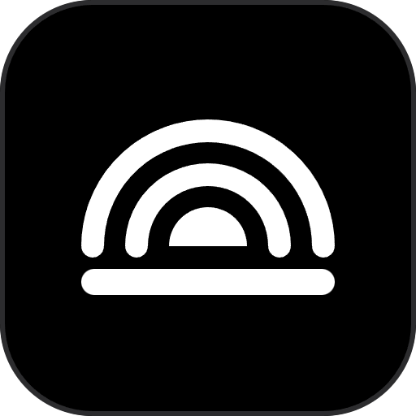
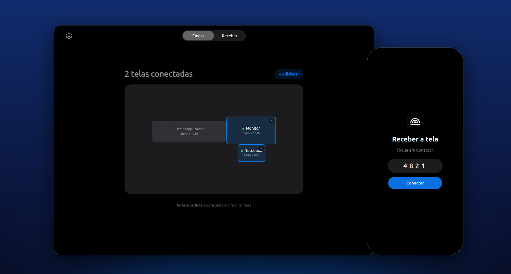

<div align="center">



# Horizonte

**Your second screen. Wireless.**

A free, open-source wireless monitor: your laptop, tablet, phone or another computer becomes the second screen of your PC.<br>
No cable, no account, nothing to set up.

[**Download**](https://github.com/mapompeo/horizonte/releases) · [Português](README.md) · [Website](https://horizonte-monitor.vercel.app?lang=en)

<br>



</div>

## Why Horizonte

- **One QR code and you are done.** Open Horizonte and point the camera of your phone or tablet at it. The extended screen opens in the browser, with nothing to install on the device.
- **As many screens as you have.** Laptop, tablet and phone at the same time. Drag each one on the map to where it sits on your desk; sizes follow the real screen.
- **Copy and paste between computers.** Text, images and files. Mouse and keyboard cross from one to the other at the screen edge.
- **Portrait or landscape.** Rotate the phone or tablet and the screen follows.
- **All yours.** Own engine (WebRTC), straight over the local network and encrypted. Nothing goes through a server or depends on third-party software.
- **Updates itself.** When a new version is out, a white button shows at the bottom: one click and done.
- **In three languages:** Portuguese, English and Spanish, with a language picker in Settings.

## Works on

| | Sends the screen | Receives the screen |
|---|:---:|:---:|
| Windows 10 and 11 | ✓ | ✓ |
| macOS (Apple and Intel), in testing | ✓ | ✓ |
| Linux (GNOME, Xorg or Wayland) | ✓ | ✓ |
| Android, iPhone and iPad | | ✓ in the browser |
| Any browser | | ✓ |

Old iPads and iPhones (down to iOS 9) work in a best-effort compatibility mode. The full list is in [docs/suportados.md](docs/suportados.md) (in Portuguese).

## How it works

1. [Download](https://github.com/mapompeo/horizonte/releases) and open Horizonte on the computer. It opens showing the QR code.
2. On the phone or tablet, point the camera at it. No camera? Tap **Copy link** and open it in the browser of the other device. On another computer with Horizonte, open **Settings › Receive another computer's screen**.
3. Done. The new screen sits next to yours.

The first time, each system asks for a permission, once: Windows installs the virtual display driver (open source, [Virtual Display Driver](https://github.com/VirtualDrivers/Virtual-Display-Driver)) and macOS asks for Screen Recording and Accessibility.

On Linux, from the terminal, in the folder where the file was downloaded:

```bash
sudo apt install ./horizonte_*.deb
```

> The installer is not digitally signed yet. On Windows, click **More info › Run anyway**. On a Mac, the first time, open **System Settings › Privacy & Security** and tap **Open Anyway**.

## Is it safe?

- **Why the firewall asks:** Horizonte accepts connections from the devices in your home, so Windows asks once whether it may use the network, like it does for games. Tick **Private networks** only.
- **What it opens:** ports 47910 to 47919 (connection between devices) and 7777 (the phone page), only on the local network.
- **Where the image goes:** straight from one device to the other, with no server, no account and no internet. Every new device needs an **Allow** on the computer.
- **Where the installer comes from:** every version is built by GitHub's own CI from the code in this repository and published in [Releases](https://github.com/mapompeo/horizonte/releases).

## Something went wrong?

In **Settings › Send diagnostics**. One click, no account: it sends the version, the system, the graphics card, the screens and the end of the app logs, without your home folder, computer or user name, device names or the end of IP addresses. The report becomes a public GitHub issue; with no internet it is saved on the Desktop so you can send it another way. Errors show a 3-digit code explained at [horizonte-monitor.vercel.app/erros](https://horizonte-monitor.vercel.app/erros?lang=en).

## Contribute

See [CONTRIBUTING](CONTRIBUTING.md) (Portuguese). Security issues: [SECURITY](SECURITY.md).

```bash
cd app
npm install
npm run dev     # the app
npm test        # tests
```

## License

[GPL-3.0](LICENSE). Made in Brazil.
