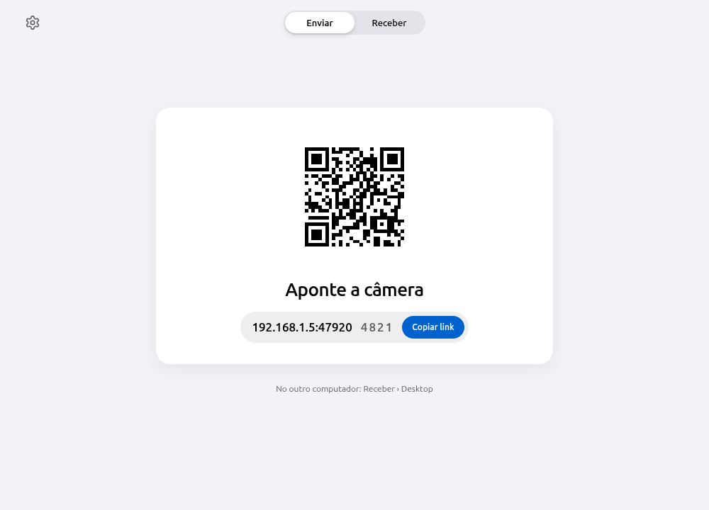
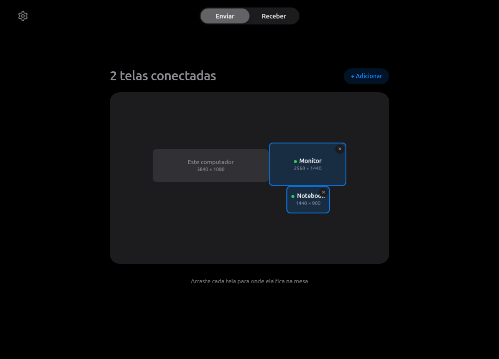
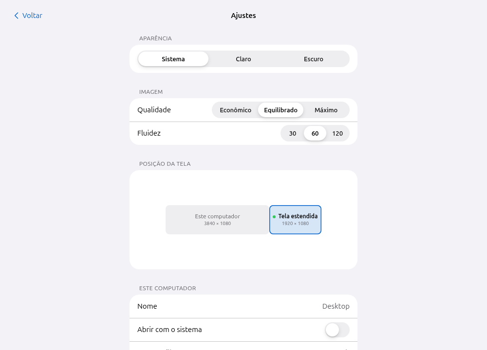
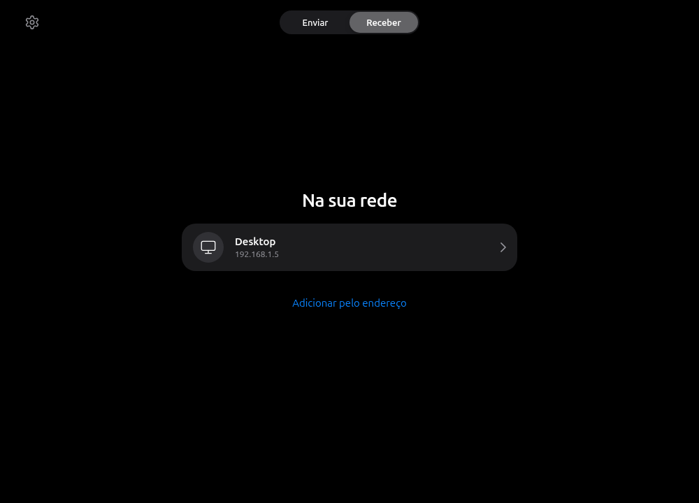

<div align="center">


# Horizonte

**Sua segunda tela. Sem fio.**

Monitor sem fio grátis e de código aberto: o notebook, o tablet, o celular ou outro computador vira a segunda tela do seu PC.<br>
Sem cabo, sem conta e sem configurar nada.

[**Baixar**](https://github.com/mapompeo/horizonte/releases) · [Site](https://horizonte-monitor.vercel.app) · [Como funciona](#como-funciona) · [Apoiar](https://github.com/sponsors/mapompeo)

<br>


</div>

## Por que o Horizonte

- **Um QR code e pronto.** Abra o Horizonte e aponte a câmera do celular ou do tablet. A tela estendida abre no navegador, sem instalar nada no aparelho.
- **Quantas telas você tiver.** Notebook, tablet e celular ao mesmo tempo. Arraste cada um no mapa para onde ele fica na sua mesa, e os tamanhos seguem a tela de verdade.
- **Copiar e colar entre os computadores.** Texto, imagens e arquivos. O mouse e o teclado passam de um para o outro pela borda da tela.
- **Deitado ou em pé.** Gire o celular ou o tablet e a tela acompanha.
- **Tudo seu.** Motor próprio (WebRTC), direto pela rede local e criptografado. Nada passa por servidor nem depende de programa de terceiros.
- **Atualiza sozinho.** Quando sai versão nova, aparece um botão branco no rodapé: um clique e pronto.

## Telas

<table>
  <tr>
    <td width="50%"></td>
    <td width="50%"></td>
  </tr>
  <tr>
    <td align="center"><b>Enviar</b><br><sub>Aponte a câmera, ou copie o link para outro aparelho</sub></td>
    <td align="center"><b>A mesa</b><br><sub>Cada tela no lugar dela, do tamanho dela</sub></td>
  </tr>
  <tr>
    <td></td>
    <td></td>
  </tr>
  <tr>
    <td align="center"><b>Ajustes</b><br><sub>Tema, qualidade e posição, sem jargão</sub></td>
    <td align="center"><b>Receber</b><br><sub>Acha o outro computador sozinho</sub></td>
  </tr>
</table>

## Funciona em

| | Envia a tela | Recebe a tela |
|---|:---:|:---:|
| Windows 10 e 11 | ✓ | ✓ |
| macOS (Apple e Intel), em teste | ✓ | ✓ |
| Linux (GNOME, Xorg ou Wayland) | ✓ | ✓ |
| Android, iPhone e iPad | | ✓ pelo navegador |
| Qualquer navegador | | ✓ |

## Como funciona

1. [Baixe](https://github.com/mapompeo/horizonte/releases) e abra o Horizonte no computador. Ele já abre mostrando o QR code.
2. No celular ou no tablet, aponte a câmera. Sem câmera, toque em **Copiar link** e abra no navegador do outro aparelho. Em outro computador com o Horizonte, toque em **Receber**.
3. Pronto. A tela nova já está do lado da sua.

Na primeira vez, cada sistema pede uma permissão, uma vez só: o Windows instala o driver de tela virtual (código aberto, [Virtual Display Driver](https://github.com/VirtualDrivers/Virtual-Display-Driver)) e o macOS pede Gravação de Tela e Acessibilidade.

No Linux, pelo terminal, na pasta onde o arquivo foi baixado:

```bash
sudo apt install ./horizonte_*.deb
```

No Ubuntu e no Debian, prefira o `.deb`: o `.AppImage` precisa do FUSE 2, que não vem instalado (`sudo apt install libfuse2t64`, ou `libfuse2` nas versões antigas).

> O instalador ainda não tem assinatura digital. No Windows, clique em **Mais informações › Executar assim mesmo**. No Mac, depois de arrastar para Aplicativos, rode uma vez `xattr -cr /Applications/Horizonte.app`.

## É seguro?

- **Por que o firewall pergunta:** o Horizonte recebe conexões dos aparelhos da sua casa, então o Windows pergunta uma vez se ele pode usar a rede, como faz com jogos e com o Steam. Marque só **Redes privadas**: em Wi-Fi público ele continua fechado. Se tocar em Cancelar sem querer, o app mostra **Liberar no firewall**.
- **O que ele abre:** as portas 47910 a 47919 (conexão entre os aparelhos) e 7777 (a página do celular), só na rede local.
- **Para onde vai a imagem:** direto de um aparelho para o outro, sem servidor, sem conta e sem internet. Cada aparelho novo precisa do **Permitir** no computador.
- **De onde vem o instalador:** cada versão é montada pela CI do próprio GitHub, a partir do código que está neste repositório, e publicada em [Releases](https://github.com/mapompeo/horizonte/releases).

## Algo deu errado?

Em **Ajustes › Enviar diagnóstico**. Um clique, sem conta: vão só a versão, o sistema e os códigos de erro.

## Apoie o projeto

O Horizonte é gratuito e vai continuar assim. Se ele te ajuda, dá para apoiar pelo [GitHub Sponsors](https://github.com/sponsors/mapompeo) ou por Pix, no botão **Apoiar** do [site](https://horizonte-monitor.vercel.app).

## Desenvolver

```bash
cd app
npm install
npm run dev     # o app
npm test        # testes
```

O site fica em `site/` (HTML, CSS e JavaScript, publicado pela Vercel):

```bash
cd site
npm test
```

## Licença

[GPL-3.0](LICENSE). Feito no Brasil.
