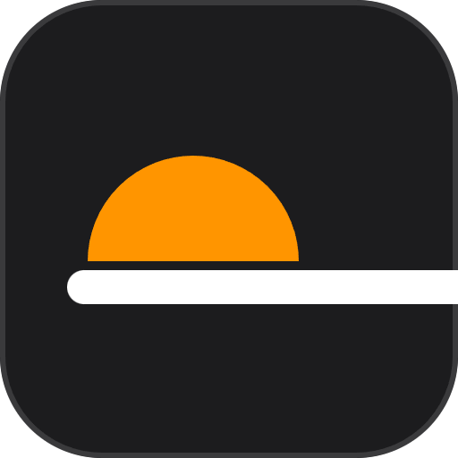
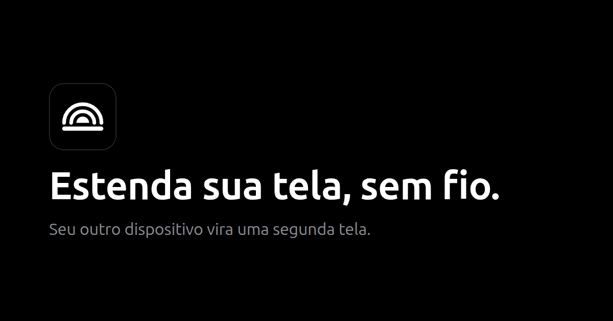

<div align="center">



# Horizonte

**Monitor sem fio. Grátis e de código aberto.**

Horizonte é um monitor sem fio: seu notebook, tablet, celular ou outro computador vira a segunda tela do seu PC.<br>
Sem cabo, sem conta e sem configurar nada.

[Baixar](https://github.com/mapompeo/horizonte/releases) · [Site](https://horizonte.vercel.app) · [Como funciona](#como-funciona)



</div>

## Por que o Horizonte

- **Um QR code e pronto.** Abra o Horizonte no computador e aponte a câmera do celular ou do tablet. A tela estendida abre no navegador, sem instalar nada no aparelho.
- **Quantas telas você tiver.** Notebook, tablet e celular ao mesmo tempo, cada um com a sua tela. Arraste cada uma para onde ela fica na mesa.
- **Deitado ou em pé.** Gire o celular ou o tablet e a tela acompanha.
- **Copiar e colar entre os computadores.** Texto, imagens e arquivos. O mouse e o teclado passam de um para o outro pela borda da tela.
- **Tudo seu.** Motor próprio (WebRTC), direto pela rede local. Nada passa por servidor nem depende de programa de terceiros.
- **Tema claro e escuro.** Segue o sistema, ou escolha nos Ajustes.
- **Atualiza sozinho.** Quando sai versão nova, aparece um botão branco no canto: um clique e pronto.

## Funciona em

| | Envia a tela | Recebe a tela |
|---|:---:|:---:|
| Windows 10 e 11 | ✓ | ✓ |
| macOS (Apple e Intel), em teste | ✓ | ✓ |
| Linux (GNOME, Xorg ou Wayland) | ✓ | ✓ |
| Android, iPhone e iPad | | ✓ pelo navegador |
| Qualquer navegador | | ✓ |

## Como funciona

1. [Baixe](https://github.com/mapompeo/horizonte/releases) e abra o Horizonte no computador. Ele abre direto em Enviar, com o QR code sempre visível.
2. No celular ou tablet, aponte a câmera para o QR code. Em outro computador, abra o Horizonte e toque em Receber.
3. Pronto. A tela nova já está do lado da sua.

Na primeira vez, cada sistema pede uma permissão, uma vez só: o Windows instala o driver de tela virtual (código aberto, [Virtual Display Driver](https://github.com/VirtualDrivers/Virtual-Display-Driver)) e o macOS pede Gravação de Tela e Acessibilidade.

> O instalador ainda não tem assinatura paga. No Windows, clique em **Mais informações › Executar assim mesmo**. No Mac, depois de arrastar para Aplicativos, rode uma vez `xattr -cr /Applications/Horizonte.app`.

## Algo deu errado?

Em **Ajustes › Enviar diagnóstico**. Um clique, sem conta: vão só a versão, o sistema e os códigos de erro.

## Desenvolver

```bash
cd app
npm install
npm run dev     # o app
npm test        # testes
```

O site fica em `site/` (HTML, CSS e JavaScript, publicado pela Vercel):

```bash
cd site
npm test
```

## Licença

[GPL-3.0](LICENSE). Feito no Brasil.
